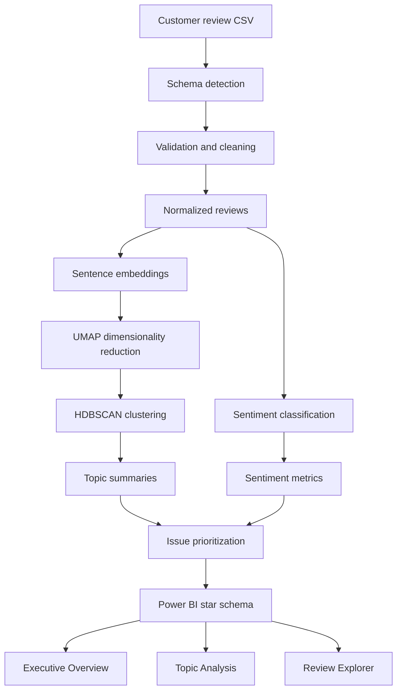

# Review Intelligence Architecture

## System overview

Review Intelligence separates the **analytics engine** from the **presentation layer** so the same review-processing pipeline can later power Power BI, a local desktop application, or a hosted web product.



## Pipeline stages

### 1. Ingestion and validation

The ingestion layer accepts review exports with different column names and maps them into a consistent internal schema. It validates usable review text, optional date/rating/product columns, removes unusable rows, and prepares clean review records.

### 2. Embeddings and topic discovery

Review text is converted into dense sentence embeddings. UMAP reduces the embedding space for clustering, and HDBSCAN identifies naturally occurring groups without requiring a predefined number of topics.

The pipeline stores reusable embeddings and cluster assignments so later stages do not need to recompute earlier work unnecessarily.

### 3. Sentiment analysis

A transformer-based classifier produces full sentiment probabilities, a sentiment label, confidence score, expected star rating, and disagreement signals between text sentiment and any supplied numeric rating.

### 4. Topic-level analytics

Cluster outputs and sentiment outputs are combined into topic-level business metrics, including review volume, negative rate, weighted sentiment, negative impact share, representative reviews, and an issue-prioritization score.

### 5. BI model

The reporting layer uses a star schema:

```text
DimDate ───────┐
DimTopic ──────┼── FactReviews
DimProduct ────┘
```

This design keeps filtering predictable and makes the Power BI report easier to extend.

## Power BI report

The report is organized into three pages:

1. **Executive Overview** — top-level KPIs, trends, and issue ranking.
2. **Topic Analysis** — topic-level comparison and prioritization.
3. **Review Explorer** — drill-down to individual reviews.

## Why this architecture

The pipeline intentionally keeps source ingestion, NLP analysis, metrics, and visualization separate. That makes it possible to:

- replace Power BI with a web UI later without rewriting the analytics engine;
- add new review sources without changing clustering or sentiment logic;
- reuse cached embeddings;
- test pipeline stages independently;
- keep customer-specific input data outside the public portfolio repository.

## Commercial evolution

A customer-facing version can wrap the same analytics engine with:

```text
Authentication
     ↓
Secure upload
     ↓
Job queue / processing
     ↓
Review Intelligence engine
     ↓
Customer dashboard
     ↓
Retention / deletion controls
```

The current project should be considered the **analytics engine + BI MVP**, not yet a hosted multi-tenant SaaS.
